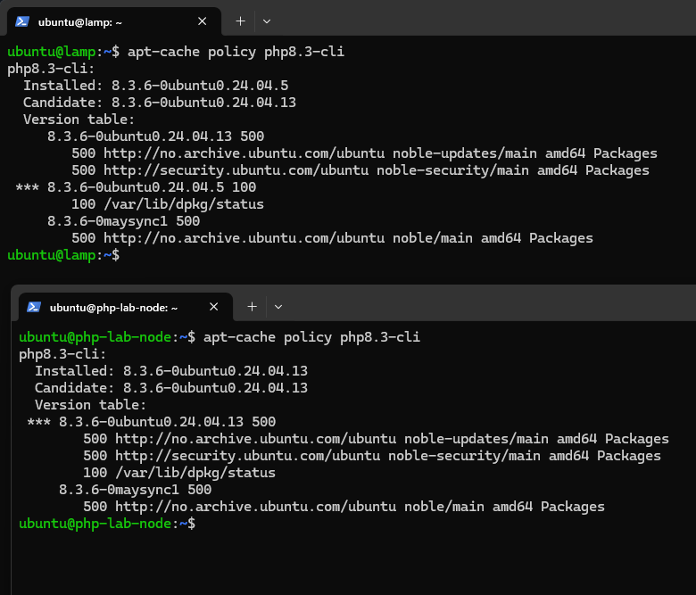
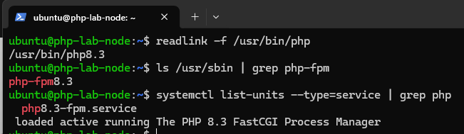
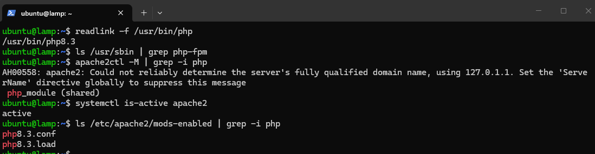
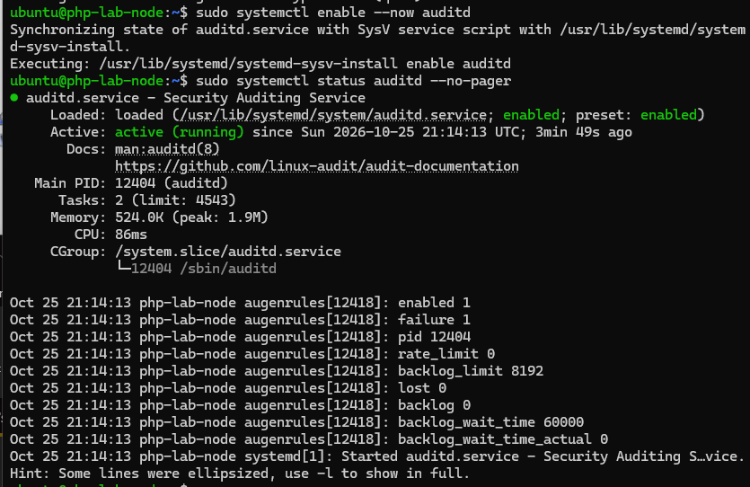
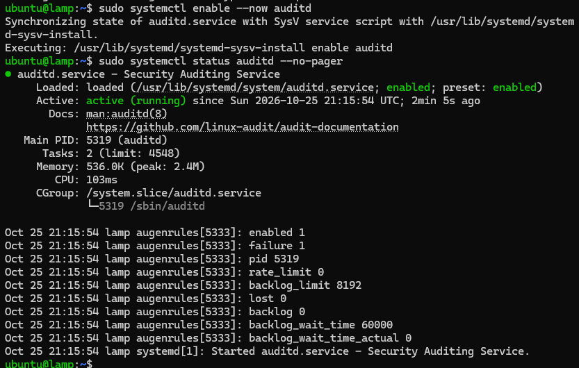
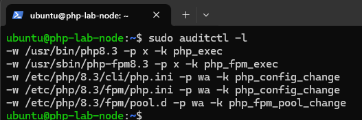
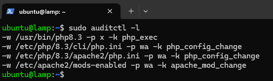
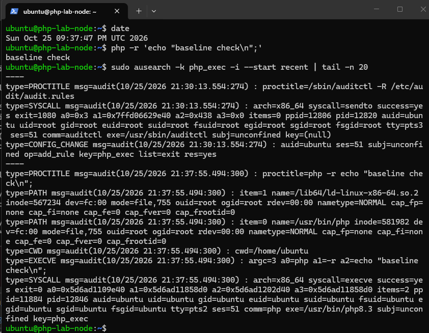
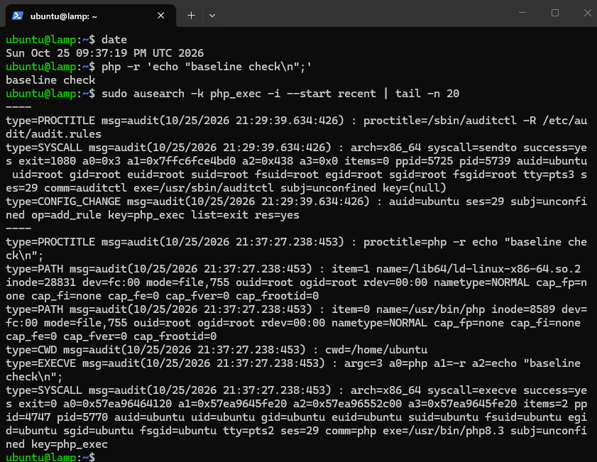

# PHP2Shell Detection & Response Lab
A defensive security lab built around the critical PHP core vulnerabilities CVE-2026-109618 and CVE-2026-109619 ("PHP2Shell"). This project focuses on detection engineering, patch verification, and incident-response documentation.

## ⚠️ Scope & Disclaimer
This repository does **not** contain working exploit code or a proof-of-concept for CVE-2026-109618 / CVE-2026-109619. Given that both vulnerabilities are critical (CVSS v4.0: 9.2), actively discussed, and reportedly reproduced by security researchers shortly after disclosure, the goal here is purely defensive: building detection logic, verifying remediation, and documenting the incident-response process a security team would follow.

## 🧩 Background
- **Disclosed:** October 21, 2026
- **CVSS v4.0 score:** 9.2 (Critical) for both CVEs
- **Type:** Remote Code Execution (RCE) in Core PHP
- **CVE-2026-109618:** Happens when PHP runs out of memory (OOM) while handling a request. Instead of cleaning up safely, PHP unexpectedly jumps out of what it was doing (`longjmp()`) and leaves some memory behind in an unfinished, "uninitialized" state. When the *next* request comes in, PHP can accidentally read or act on that leftover memory instead of fresh data. By intentionally forcing out-of-memory conditions over and over, an attacker can turn this leftover memory into a way to run their own code on the server.
- **CVE-2026-109619:** Works the same way, but is triggered by a fatal error instead of an out-of-memory condition. When PHP aborts a request after a fatal error, it can leave a piece of memory pointing to a spot that has already been freed up ("dangling pointer"). A later request may then read from, or make decisions based on that now-invalid memory, which can also be abused to run unauthorized code on the server.
**In short:** both bugs come from the same root cause PHP not cleaning up memory properly when a request is cut short (by an OOM error or a fatal error) and both can be escalated from "memory corruption" to full remote code execution.
- **Patched in:** PHP 8.5.12, 8.4.27, 8.3.36, 8.2.35 (minimal source backports also released for 7.4, 8.0, 8.1)
- **Sources:** PHP Security Team advisory, additional analysis from watchTowr, SOC Prime, Fastly, Bitsight

## 🛠 Technology Stack
- **OS/Infrastructure:** Linux (Ubuntu Server), VMware
- **Web stack:** Apache/Nginx + php-fpm
- **Behavioral monitoring:** auditd / Falco
- **Detection engineering:** Sigma rules
- **Automation:** Python (log analysis)

## 🚀 Project Roadmap
- [X] Phase 1: php-lab-node (patched reference)
 - [X] Phase 1b: lamp (legacy, unpatched)
- [X] Phase 2: Establish baseline logging & process monitoring
- [ ] Phase 3: Build detection logic (Sigma rule + Python log analyzer)
- [ ] Phase 4: Patch the environment and verify remediation
- [ ] Phase 5: Write an incident-response-style report

*Detailed logs and documentation will be added as each phase is completed.*


## 📖 Step-by-Step Implementation Log

### Phase 1: Lab Environment Setup (`php-lab-node`)

#### 1. Virtual Machine and Base System
- **Host:** VMware Workstation, Ubuntu Server 24.04 LTS (`php-lab-node`)
- **Specs:** 2 vCPUs, 4 GB RAM, 25 GB disk


The system was updated and SSH was enabled, following the same process as `k8s-homelab-node`.

```bash
sudo apt update && sudo apt upgrade -y
ip a
sudo ufw allow ssh
sudo ufw enable
```


#### 2. PHP Installation
PHP CLI and PHP-FPM were installed from the Ubuntu repository.

```bash
sudo apt install -y php-cli php-fpm
php -v
```


The reported version (8.3.6) is below the upstream fix version (8.3.36). Since Ubuntu backports security fixes without changing the upstream version number, the package changelog and the Ubuntu CVE tracker were checked before drawing a conclusion.

#### 3. Changelog and CVE Tracker Verification
```bash
apt changelog php8.3-cli 2>/dev/null 
```


This retrieves the changelog of the installed package from Ubuntu's servers, listing the security fixes included in that package version. `2>/dev/null` suppresses error messages.

Both Ubuntu CVE tracker entries were checked:
- https://ubuntu.com/security/CVE-2026-109618
- https://ubuntu.com/security/CVE-2026-109619

Both list `8.3.6-0ubuntu0.24.04.13` (noble) as the fixed version.


#### 4. Assessment
- **Patch status:** Not affected
- **Reasoning:** Installed package `8.3.6-0ubuntu0.24.04.13` equals the fixed version listed on the Ubuntu tracker for both CVEs. The changelog shows no pending update, and `apt-cache policy` reports Installed and Candidate as the same version.
- **Verification sources:** `php -v`, `apt changelog`, Ubuntu CVE tracker (CVE-2026-109618 / CVE-2026-109619), `apt-cache policy`.
- **Limitation:** Version-based checks are supplemented by package evidence because Ubuntu backports fixes without changing the upstream version number.

---

### Phase 1b: Legacy Node Assessment (`lamp`)

#### Background
After confirming the patched baseline on `php-lab-node`, I located an older LAMP server (LAMP stands for Linux, Apache, MariaDB, PHP) in my VMware library that I had built previously but had not used for some time. Since the purpose of this lab is to compare patched and unpatched states, this server provides a useful counterpart to the reference node.


#### 1. Access and Baseline Preservation
The server was already fully configured, with SSH enabled from the initial build. Unlike `php-lab-node`, it was **not** upgraded at this stage. The aim was to preserve the existing PHP version as an unpatched baseline, so that the vulnerable state could be documented before any remediation.


#### 2. Version Check
```bash
php -v
```


The version number alone does not determine patch status, so the changelog was checked as well.

#### 3. Changelog Verification
```bash
apt changelog php8.3-cli 2>/dev/null | head -n 3
apt changelog php8.3-cli 2>/dev/null | grep CVE
```


The output shows the installed package (`8.3.6-0ubuntu0.24.04.5`, noble-security) and the full CVE list from the changelog, filtered with `grep CVE`. CVE-2026-109618 and CVE-2026-109619 do not appear.


#### 4. Disable Automatic Updates
To keep the vulnerable state stable during documentation, `unattended-upgrades` was stopped and disabled:

```bash
sudo systemctl stop unattended-upgrades
sudo systemctl disable unattended-upgrades
sudo systemctl status unattended-upgrades --no-pager
sudo nano /etc/apt/apt.conf.d/20auto-upgrades
```

Within `20auto-upgrades`, both periodic settings were set to `"0"`:
APT::Periodic::Update-Package-Lists "0";
APT::Periodic::Unattended-Upgrade "0";

Status after change: `inactive (dead)`, `disabled`.


#### 5. Repository Verification
```bash
date
sudo apt update
apt-cache policy php8.3-cli
```

`apt update` refreshes the local package index without installing anything. Before this step, apt's cache could be outdated, so `Candidate` might not show the fix. After the refresh, `apt-cache policy` shows:

- **Installed:** 8.3.6-0ubuntu0.24.04.5
- **Candidate:** 8.3.6-0ubuntu0.24.04.13 (from noble-updates and noble-security)



The same command on `php-lab-node` (Phase 1) shows the fixed version as installed, which gives a direct comparison:

- `lamp`: Installed `8.3.6-0ubuntu0.24.04.5`, Candidate `8.3.6-0ubuntu0.24.04.13`. Affected, update available.
- `php-lab-node`: Installed `8.3.6-0ubuntu0.24.04.13`, Candidate `8.3.6-0ubuntu0.24.04.13`. Patched, no update pending.

The `apt changelog` request for `.13` returned 404 from the changelog server, so the repository and tracker are used as primary evidence instead.


#### 6. Cross-reference with Ubuntu CVE Tracker
Both tracker entries list `8.3.6-0ubuntu0.24.04.13` (noble) as the fixed version:
- https://ubuntu.com/security/CVE-2026-109618
- https://ubuntu.com/security/CVE-2026-109619

The installed package `8.3.6-0ubuntu0.24.04.5` is not listed. The tracker shows only the fixed version per release, so this is expected. The installed version is older than the fixed version, and the repository check in step 5 confirms the update is available.


#### 7. Assessment
- **Patch status:** Affected
- **Reasoning:** Installed `8.3.6-0ubuntu0.24.04.5` is older than the fixed version `8.3.6-0ubuntu0.24.04.13`. Confirmed by changelog, tracker, and repository candidate.
- **Remediation:** Pending. Will be applied and verified in Phase 4 to document the before/after state.


### Phase 2: Baseline Logging with auditd

#### Goal
Confirm that the Linux audit framework (`auditd`) records PHP execution and PHP configuration changes on both nodes. These events are the input for the detection work in Phase 3.

#### Lab architecture
- **Target nodes:** `php-lab-node` (patched) and `lamp` (unpatched). Audit rules run here and generate the events.
- **Analysis host:** Kali Linux desktop. Connects over SSH and analyses the collected logs in Phase 3.
- **Log transfer:** Logs are copied to the analysis host with `scp`. No detection logic runs on the target nodes.

#### 1. Verify PHP Integration

**`php-lab-node`: PHP-FPM**
```bash
readlink -f /usr/bin/php
ls /usr/sbin | grep php-fpm
systemctl list-units --type=service | grep php
```



Result: `/usr/bin/php` resolves to `/usr/bin/php8.3`, `php-fpm8.3` is present, and `php8.3-fpm.service` is active.

**`lamp`: mod_php (Apache)**
```bash
readlink -f /usr/bin/php
ls /usr/sbin | grep php-fpm
apache2ctl -M | grep -i php
systemctl is-active apache2
ls /etc/apache2/mods-enabled | grep -i php
```



Result: `/usr/bin/php` resolves to `/usr/bin/php8.3`. No `php-fpm` binary is present. Apache reports `php_module (shared)`, and `php8.3.load` and `php8.3.conf` are enabled. PHP runs inside Apache, so the php-fpm audit rule does not apply to this node.

`apache2ctl` printed an `AH00558` warning (ServerName not set). It does not affect the result.

#### 2. Install and Enable auditd
`auditd` is the Linux kernel audit framework. It records security-relevant events such as program execution and file changes.

```bash
sudo apt install -y auditd audispd-plugins
sudo systemctl enable --now auditd
sudo systemctl status auditd --no-pager
```





#### 3. Audit Rules
Rules were written to `/etc/audit/rules.d/php-baseline.rules`. They watch the PHP binary for execution, and the PHP configuration files for writes and attribute changes. Directory watches in auditd are not recursive, so configuration files are referenced individually where possible.


```bash
sudo nano /etc/audit/rules.d/php-baseline.rules
```


`php-lab-node`:
```
-w /usr/bin/php8.3 -p x -k php_exec
-w /usr/sbin/php-fpm8.3 -p x -k php_fpm_exec
-w /etc/php/8.3/cli/php.ini -p wa -k php_config_change
-w /etc/php/8.3/fpm/php.ini -p wa -k php_config_change
-w /etc/php/8.3/fpm/pool.d/ -p wa -k php_fpm_pool_change
```

`lamp`:
```
-w /usr/bin/php8.3 -p x -k php_exec
-w /etc/php/8.3/cli/php.ini -p wa -k php_config_change
-w /etc/php/8.3/apache2/php.ini -p wa -k php_config_change
-w /etc/apache2/mods-enabled/ -p wa -k apache_mod_change
```

Loaded and verified with:
```bash
sudo augenrules --load
sudo auditctl -l
```

The `-w` flag sets the path to watch. `-p x` logs execution of that path, and `-p wa` logs writes and attribute changes. The `-k` flag attaches a key so the events can be found later with `ausearch`.






#### 4. Baseline Event
A harmless PHP CLI command was run to generate a known event, and the audit log was searched by key.

```bash
date
php -r 'echo "baseline check\n";'
sudo ausearch -k php_exec -i --start recent | tail -n 20
```





Timestamp of the test: `Sun Oct 25 2026, 21:37 UTC` on both nodes.

In the output, `key=php_exec` shows which rule matched, and `exe=/usr/bin/php8.3` shows the binary that ran. The `comm=php` field is the process name. The output also contains a `key=(null)` entry from `auditctl -R`, which is the rule loading step and not a PHP event.

#### 5. Result
- **php-lab-node:** audit event recorded for `php_exec` key: **yes** (`exe=/usr/bin/php8.3`, `comm=php`).
- **lamp:** audit event recorded for `php_exec` key: **yes** (`exe=/usr/bin/php8.3`, `comm=php`).
- **Observation:** Both nodes record CLI execution of PHP under the `php_exec` key.

#### 6. Assessment
- **Monitoring status:** Partially effective.
- **Reasoning:** `auditd` records CLI execution of PHP on both nodes, and the configuration watches are loaded. This is enough to build detection logic on in Phase 3.
- **Gap:** Requests served through Apache `mod_php` on `lamp` do not trigger the `php_exec` rule, because the process running the code is Apache, not `/usr/bin/php8.3`. The unpatched node is therefore only partly covered.
- **Next step:** Phase 3 builds detection on the CLI events. The web-request gap is documented here, and a separate test for it is planned in a later phase.
Claude arbeider direkte med kodebasen din
