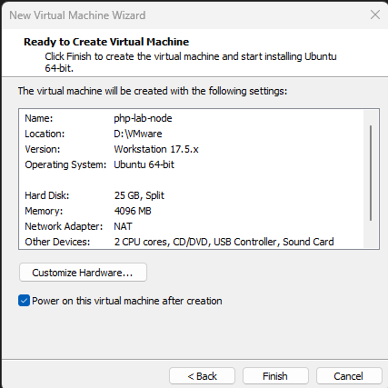
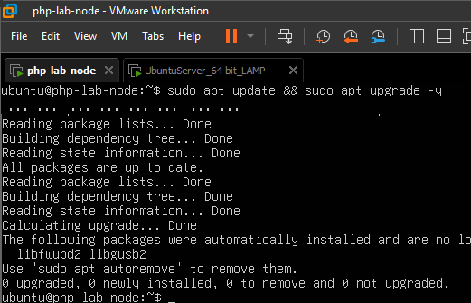
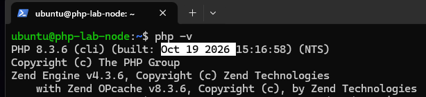
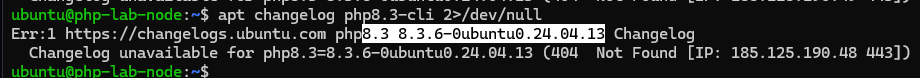
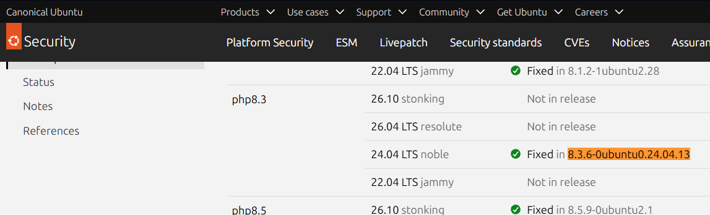
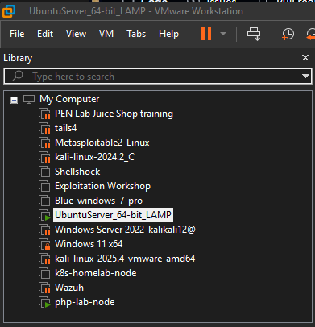
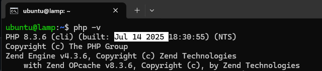
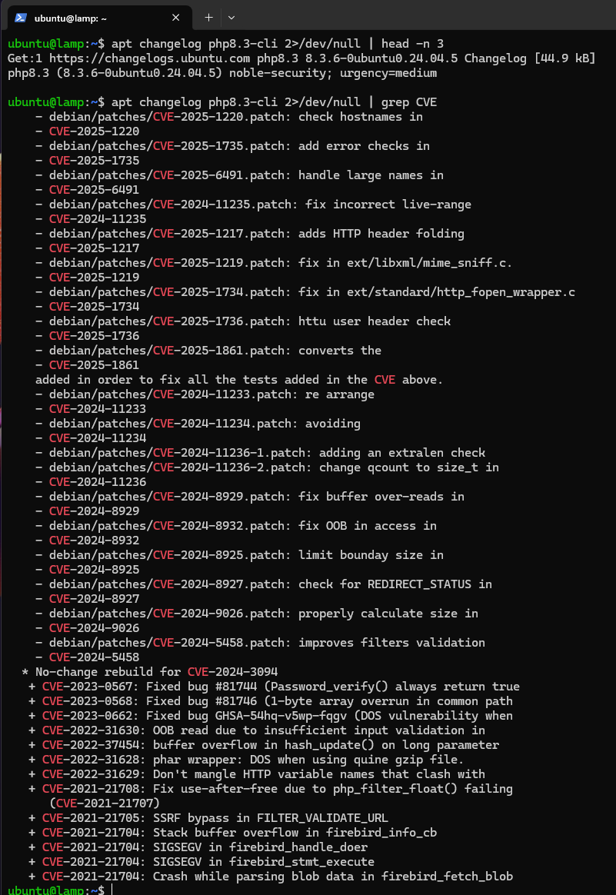

# PHP2Shell Detection & Response Lab
A defensive security lab built around the critical PHP core vulnerabilities CVE-2026-109618 and CVE-2026-109619 ("PHP2Shell"). This project focuses on detection engineering, patch verification, and incident-response documentation.

## ⚠️ Scope & Disclaimer
This repository does **not** contain working exploit code or a proof-of-concept for CVE-2026-109618 / CVE-2026-109619. Given that both vulnerabilities are critical (CVSS v4.0: 9.2), actively discussed, and reportedly reproduced by security researchers shortly after disclosure, the goal here is purely defensive: building detection logic, verifying remediation, and documenting the incident-response process a security team would follow.

## 🧩 Background
- **Disclosed:** October 21, 2026
- **CVSS v4.0 score:** 9.2 (Critical) for both CVEs
- **Type:** Remote Code Execution (RCE) in Core PHP
- **CVE-2026-109618:** Happens when PHP runs out of memory (OOM) while handling a request. Instead of cleaning up safely, PHP unexpectedly jumps out of what it was doing (`longjmp()`) and leaves some memory behind in an unfinished, "uninitialized" state. When the *next* request comes in, PHP can accidentally read or act on that leftover memory instead of fresh data. By intentionally forcing out-of-memory conditions over and over, an attacker can turn this leftover memory into a way to run their own code on the server.
- **CVE-2026-109619:** Works the same way, but is triggered by a fatal error instead of an out-of-memory condition. When PHP aborts a request after a fatal error, it can leave a piece of memory pointing to a spot that has already been freed up ("dangling pointer"). A later request may then read from, or make decisions based on that now-invalid memory, which can also be abused to run unauthorized code on the server.
**In short:** both bugs come from the same root cause PHP not cleaning up memory properly when a request is cut short (by an OOM error or a fatal error) and both can be escalated from "memory corruption" to full remote code execution.
- **Patched in:** PHP 8.5.12, 8.4.27, 8.3.36, 8.2.35 (minimal source backports also released for 7.4, 8.0, 8.1)
- **Sources:** PHP Security Team advisory, additional analysis from watchTowr, SOC Prime, Fastly, Bitsight

## 🛠 Technology Stack
- **OS/Infrastructure:** Linux (Ubuntu Server), VMware
- **Web stack:** Apache/Nginx + php-fpm
- **Behavioral monitoring:** auditd / Falco
- **Detection engineering:** Sigma rules
- **Automation:** Python (log analysis)

## 🚀 Project Roadmap
- [X] Phase 1: Deploy a vulnerable lab environment (pre-patch PHP version)
- [ ] Phase 2: Establish baseline logging & process monitoring
- [ ] Phase 3: Build detection logic (Sigma rule + Python log analyzer)
- [ ] Phase 4: Patch the environment and verify remediation
- [ ] Phase 5: Write an incident-response-style report

*Detailed logs and documentation will be added as each phase is completed.*


## 📖 Step-by-Step Implementation Log

### Phase 1: Lab Environment Setup (`php-lab-node`)

#### 1. Virtual Machine and Base System
- **Host:** VMware Workstation, Ubuntu Server 24.04 LTS (`php-lab-node`)
- **Specs:** 2 vCPUs, 4 GB RAM, 25 GB disk



The system was updated and SSH was enabled, following the same process as `k8s-homelab-node`.

```bash
sudo apt update && sudo apt upgrade -y
ip a
sudo ufw allow ssh
sudo ufw enable
```



#### 2. PHP Installation
PHP CLI and PHP-FPM were installed from the Ubuntu repository.

```bash
sudo apt install -y php-cli php-fpm
php -v
```



Output: PHP 8.3.6 (cli) (built: Oct 19 2026 15:16:58) (NTS)


The reported version (8.3.6) is below the upstream fix version (8.3.36). Since Ubuntu backports security fixes without changing the upstream version number, the package changelog and the Ubuntu CVE tracker were checked before drawing a conclusion.

#### 3. Changelog and CVE Tracker Verification
```bash
apt changelog php8.3-cli 2>/dev/null 
```


This retrieves the changelog of the installed package from Ubuntu's servers, listing the security fixes included in that package version. `2>/dev/null` suppresses error messages.

Both Ubuntu CVE tracker entries were checked:
- https://ubuntu.com/security/CVE-2026-109618
- https://ubuntu.com/security/CVE-2026-109619

Both list `8.3.6-0ubuntu0.24.04.13` (noble) as the fixed version.



#### 4. Assessment
- **Patch status:** Not affected
- **Reasoning:** The installed package `8.3.6-0ubuntu0.24.04.13` is the version in which Ubuntu applied the fix already.

---

### Phase 1b: Legacy Node Assessment (`lamp`)

#### Background
After confirming the patched baseline on `php-lab-node`, I located an older LAMP server (LAMP stands for Linux, Apache, MariaDB, PHP) in my VMware library that I had built previously but had not used for some time. Since the purpose of this lab is to compare patched and unpatched states, this server provides a useful counterpart to the reference node.



#### 1. Access and Baseline Preservation
The server was already fully configured, with SSH enabled from the initial build. Unlike `php-lab-node`, it was **not** upgraded at this stage. The aim was to preserve the existing PHP version as an unpatched baseline, so that the vulnerable state could be documented before any remediation.


#### 2. Version Check
```bash
php -v
```



Output: PHP 8.3.6 (cli) (built: Jul 14 2025 18:30:55) (NTS)

The version number alone does not determine patch status, so the changelog was checked as well.

#### 3. Changelog Verification
```bash
apt changelog php8.3-cli 2>/dev/null | head -n 3
apt changelog php8.3-cli 2>/dev/null | grep CVE
```



The output shows the installed package (`8.3.6-0ubuntu0.24.04.5`, noble-security) and the full CVE list from the changelog, filtered with `grep CVE`. CVE-2026-109618 and CVE-2026-109619 do not appear.


#### 4. Cross-reference with Ubuntu CVE Tracker

did not found `8.3.6-0ubuntu0.24.04.5` on any of these, maybe to old?


